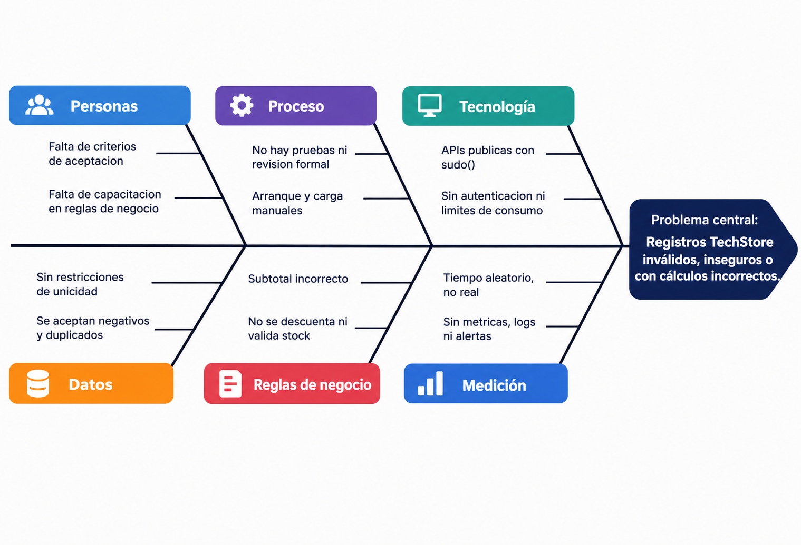
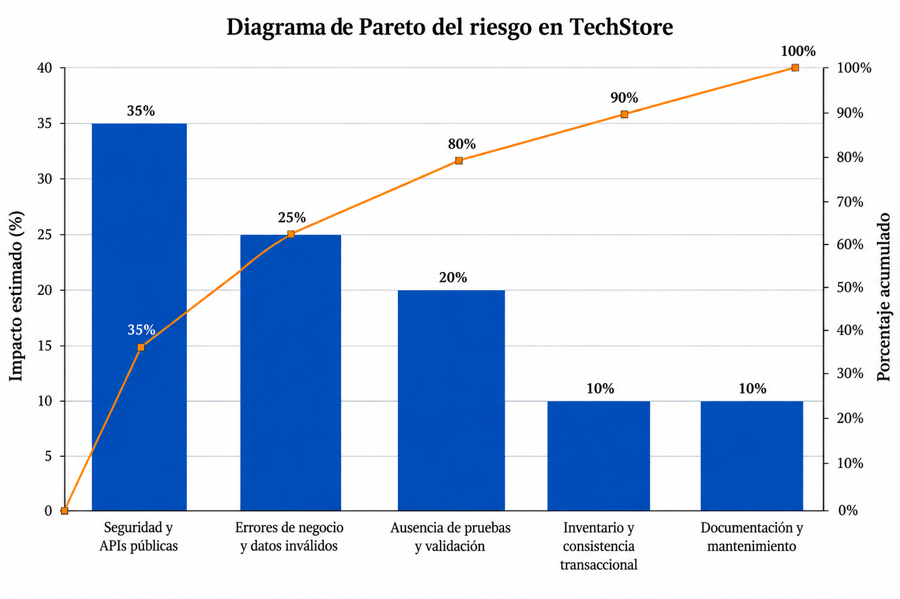

# TechStore Quality Taller

## APIs

El modulo expone las siguientes rutas:

| Metodo | Ruta | Funcion |
|---|---|---|
| POST | `/api/clientes` | Crea un cliente. |
| POST | `/api/productos` | Crea un producto. |
| POST | `/api/ventas` | Crea una venta y devuelve sus calculos. |
| POST | `/techstore_quality/api/operacion` | Ejecuta operaciones matematicas mediante JSON-RPC. |

### ISO/IEC 12207 ¿Qué fases del ciclo de vida presentan problemas?

1. **Análisis:** no estan definidos los campos obligatorios, las reglas de stock, la autenticacion ni los criterios de aceptacion.
2. **Diseno:** no hay una estrategia de seguridad, manejo de errores, versionado de API ni control transaccional del inventario.
3. **Desarrollo:** existen errores en los calculos y se aceptan valores invalidos. La API, los modelos y los menus no tienen un contrato documentado comun.
4. **Pruebas:** no existen pruebas del sistema
5. **Mantenimiento:** el arranque depende de comandos manuales y no se documentan monitoreo, logs ni recuperacion.

## ISO/IEC 25010 ¿Qué características de calidad están afectadas?

- **Adecuacion funcional:** calculos incorrectos y reglas de venta incompletas.
- **Seguridad:** APIs publicas, uso de `sudo()` y exposicion de excepciones.
- **Fiabilidad:** no se controlan datos invalidos ni inconsistencias de stock.
- **Eficiencia de desempeno:** uso de pausas artificiales y ausencia de metricas reales.
- **Mantenibilidad:** reglas embebidas en el codigo y falta de pruebas.
- **Compatibilidad:** las vistas XML originales usaban `tree`, formato que requirio adaptacion a Odoo 18.
- **Usabilidad:** los menus pueden confundirse con otros modelos de TechStore.
- **Calidad de datos:** se permiten duplicados, referencias no unicas y valores negativos.

## CMMI ¿En qué nivel de madurez considera que está el proceso?

El proceso se considera **Nivel 1: Inicial** porque depende de ejecucion manual, no tiene pruebas automatizadas, carece de metricas historicas y no define criterios formales de aceptacion. Las reglas de negocio y la calidad dependen de revisiones puntuales, no de un proceso repetible.

## Six Sigma: DMAIC

### Define

Reducir ventas invalidas, accesos no autorizados, calculos incorrectos y diferencias entre stock real y stock registrado.

### Measure

Medir porcentaje de respuestas 4xx/5xx, registros invalidos aceptados, ventas sin stock, diferencias de calculo, duplicados y tiempo de respuesta p95.

### Analyze

Las causas principales son la falta de validacion centralizada, el uso de APIs publicas con `sudo()`, reglas incompletas, ausencia de restricciones y falta de pruebas.

### Problemas de las APIs

- Las rutas usan `auth='public'`, `csrf=False` y `sudo()`, por lo que permiten crear registros sin autenticacion.
- No hay validacion completa de campos, tipos, precios, cantidades ni stock.
- Se aceptan cantidades negativas, descuentos excesivos y stock negativo.
- Los errores devuelven el texto de la excepcion interna al cliente.
- No hay autenticacion por token, limites de consumo, idempotencia ni versionado.
- Solo existen operaciones de creacion; faltan consultas, actualizaciones y eliminaciones.
- La division y el porcentaje pueden fallar por division entre cero.
- La operacion `avg` esta mal implementada: calcula `(a + b) * 2`.
- No existe documentacion OpenAPI ni pruebas automatizadas de los contratos.

## Problemas funcionales encontrados

- El subtotal se calcula como `cantidad + precio_unitario - descuento`; deberia calcularse normalmente como `cantidad * precio_unitario - descuento`.
- Si la cantidad es mayor que cinco, el precio unitario se duplica automaticamente sin una regla de negocio documentada.
- La venta no descuenta stock ni valida que exista stock suficiente.
- Se permiten ventas con cantidad cero o negativa.
- No hay restricciones de unicidad para cedulas, codigos de producto o referencias de venta.
- El estado de calidad se establece siempre como `observado`.
- El tiempo de respuesta se genera aleatoriamente y no mide el tiempo real de procesamiento.
- El metodo `create` de ventas no esta preparado para operaciones por lotes y genera una advertencia de Odoo.
- El manifiesto no declara una licencia.
- No existen pruebas unitarias, de integracion, seguridad o carga.

## Lluvia de ideas

- Agregar autenticacion y autorizacion por usuario o token.
- Validar esquemas JSON y campos obligatorios.
- Impedir cantidades, precios y descuentos invalidos.
- Crear restricciones SQL para cedula, codigo y referencia.
- Validar y descontar stock dentro de una transaccion.
- Corregir el calculo del subtotal y las operaciones matematicas.
- Separar errores tecnicos de errores funcionales.
- No mostrar excepciones internas al consumidor de la API.
- Agregar endpoints GET, PUT/PATCH y DELETE con paginacion y filtros.
- Implementar idempotencia, limites de consumo y versionado.
- Crear pruebas unitarias, de integracion, seguridad, concurrencia y carga.
- Documentar la API con OpenAPI.
- Agregar logs estructurados, monitoreo y alertas.
- Medir tiempos reales de respuesta y resultados de calidad.
- Preparar el metodo `create` para operaciones por lotes.
- Definir una configuracion de arranque reproducible y declarar la licencia.

## Espina de pescado: causas de datos y ventas no confiables

**Problema central:** registros TechStore invalidos, inseguros o con calculos incorrectos.

## Analisis Pareto

La siguiente distribucion es una priorizacion cualitativa por impacto; debe confirmarse con datos reales de produccion.

| Causa | Impacto estimado |
|---|---:|
| Seguridad y APIs publicas | 35% |
| Errores de negocio y datos invalidos | 25% |
| Ausencia de pruebas y validacion | 20% |
| Inventario y consistencia transaccional | 10% |
| Documentacion y mantenimiento | 10% |

Las tres primeras causas concentran aproximadamente el 80% del riesgo y deben atenderse primero.

### Improve

Proteger las APIs, validar entradas, corregir calculos, controlar stock, agregar restricciones de unicidad, crear pruebas y documentar los endpoints.

### Control

Usar pruebas automaticas en cada cambio, monitorear errores HTTP y stock, registrar logs estructurados, revisar permisos y medir periodicamente el tiempo de respuesta.

## Conclusion

El modulo cumple como escenario educativo para analizar fallas de calidad, pero antes de considerarlo listo para produccion requiere corregir seguridad, validacion, calculos, inventario, pruebas y documentacion.

## Resumen de cambios implementados

- Se protegieron las APIs de clientes, productos, ventas y operaciones para requerir un usuario autenticado.
- Se eliminaron las escrituras mediante `sudo()` desde las APIs.
- Se agregaron validaciones para campos obligatorios, correos, precios, cantidades, descuentos, clientes y productos.
- Se agregaron controles contra nuevos duplicados de cedulas, codigos de producto y referencias de venta.
- Se corrigio el calculo del subtotal: `cantidad * precio_unitario - descuento`.
- Se corrigieron las operaciones matematicas `avg`, division y porcentaje.
- Se agrego control transaccional del stock y soporte para crear ventas por lotes.
- Se impide modificar el producto o la cantidad de una venta creada sin recalcular el inventario.
- Se mejoro el manejo de errores para no exponer excepciones internas.
- Se agrego la licencia `LGPL-3` al manifiesto.
- Se agregaron pruebas automatizadas de ventas, stock, duplicados, validaciones y operaciones por lotes.
- Se ejecutaron 100 escenarios aleatorios reproducibles con semilla `20261010`.
- Resultado final: 9 pruebas automatizadas, 100 escenarios aleatorios, `0 failed` y `0 error(s)`.
